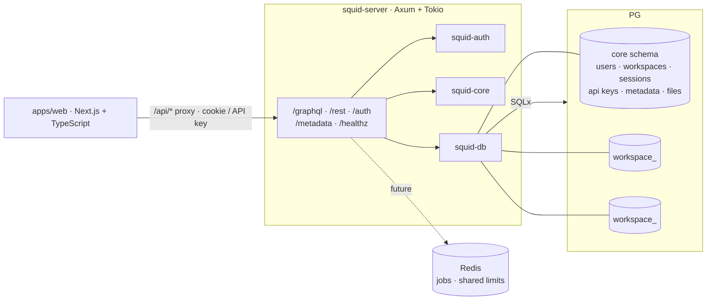

# Squid-CRM — Systems Design Audit

Audit date: 2026-10-27
Repository: `Squid`
Revision observed: commit dated 2026-10-25, working tree clean
License: AGPL-3.0-only
Status: alpha (per README)

## Overview

Squid-CRM is a self-hosted, multi-tenant CRM with a Rust/Axum/PostgreSQL
backend and a first-party Next.js/TypeScript web client. It exposes REST and
GraphQL APIs, schema-per-workspace tenancy, metadata-driven custom objects and
fields, role/permission enforcement, full-text search, PostgreSQL-backed files
(with optional S3), durable jobs, and HMAC-signed webhooks with a delivery log
and replay.

The Rust API is intended as the trust boundary. The Next.js app proxies
`/api/*` to the Rust server so the browser's HttpOnly session cookie remains
same-origin. API keys are accepted directly by data APIs; user access tokens
are accepted only by the metadata GraphQL API.

## Architecture

Crate responsibilities:

- `squid-core` — configuration, domain models, errors, permission types.
- `squid-db` — SQLx pool, migrations, tenant schema creation, repositories.
- `squid-auth` — Argon2id passwords, HS256 JWTs, opaque refresh tokens,
  sessions, API keys, `AuthContext`.
- `squid-api` — Axum router, REST handlers, GraphQL schema/resolvers, CORS,
  auth/CSRF/idempotency middleware, webhook delivery, job execution.
- `squid-server` — runnable binary.
- `apps/web` — Next.js App Router frontend.
- `python/` — optional Python client.
- `docs/` — API, architecture, ADRs, threat model, known limitations.

Tenancy is PostgreSQL-native: one schema per workspace, plus a shared `core`
schema for identity/metadata. The workspace schema name is derived from a
validated UUID, and dynamic SQL uses a validated `{schema}` placeholder rather
than user text.

## Entry Points

Rust API routes (`crates/squid-api/src/lib.rs`):

- `POST /auth/signup`, `/auth/signin`, `/auth/refresh`, `/auth/signout`
- `POST /graphql` and `POST /metadata` (plus GET playground HTML)
- `/rest/*` for standard and custom objects
- `/files/upload/{id}` (PUT), `/files/{id}` (GET)
- `/healthz`
- Webhook CRUD, deliveries, and replay through GraphQL metadata APIs
- Admin job enqueue/run, maintenance, and `http.request` jobs

Frontend entry points: `apps/web` routes for dashboard/search, standard and
custom objects, files, and settings (members, roles, API keys, webhooks, data
model, views, custom objects, jobs, GraphQL console, profile).

## Dependencies

Workspace version 0.1.0, Rust 1.85+, edition 2021, AGPL-3.0-only.

- `axum` 0.8 / `axum-extra` 0.10 — HTTP, cookies.
- `tokio` 1 — async runtime.
- `sqlx` 0.8 — PostgreSQL, migrations, TLS via rustls.
- `async-graphql` 7 — GraphQL schema and execution.
- `jsonwebtoken` 9 — JWT signing/verification.
- `argon2` 0.5 / `password-hash` — password hashing.
- `reqwest` 0.12 with rustls — webhooks and `http.request` jobs.
- `tower-http` 0.6 — trace, CORS, body limit.
- `chrono`, `uuid`, `serde`, `serde_json`, `sha2`, `hmac`, `hex`, `base64`,
  `regex`.
- PostgreSQL 16; Redis is shown as a future/shared-limiter dependency, not
  currently required.

## Module Structure

- `crates/squid-api/src/lib.rs` — router, middleware, auth resolution, cookie
  helpers, readiness.
- `crates/squid-api/src/rest.rs` — REST handlers, custom objects, files,
  webhooks, jobs, `http_job_url_allowed`.
- `crates/squid-api/src/graphql.rs` — GraphQL schema/resolvers, metadata,
  roles, webhooks, `validate_webhook_target`.
- `crates/squid-api/src/auth.rs` — signup/signin/refresh/signout.
- `crates/squid-api/src/rate_limit.rs` — in-process auth burst limiter.
- `crates/squid-db/src/` — migrations, repositories, tenant schemas.
- `crates/squid-auth/src/` — tokens, sessions, API keys, passwords.
- `apps/web/` — Next.js frontend and typed API clients.
- `docs/architecture/overview.md`, `docs/threat-model.md`,
  `docs/known-limitations.md`, `docs/decision-log.md`.

## Data, State, APIs, and Contracts

### Identity and sessions

- Passwords hashed with Argon2id.
- Access/login JWTs are short-lived: login token 300 s, access token 3600 s by
  default.
- Refresh tokens are opaque, 32-byte random values, stored hashed, rotated
  atomically on use, and replay-safe via session ID.
- Session cookies are `HttpOnly; SameSite=Lax`, with `Secure` controlled by
  `COOKIE_SECURE` (default false).
- API keys are hashed at rest, expiring and revocable per request.
- `APP_SECRET` must be at least 32 characters; rotating it invalidates JWTs.

### Tenancy and authorization

- Workspace schema derived from a validated UUID; membership re-checked on
  every request.
- `AuthContext` carries user, workspace, role, session, and auth method.
- REST/GraphQL capability checks and admin guards enforce permissions; built-in
  roles are immutable.
- CORS uses `AllowOrigin::exact(frontend_url)` with credentials, not a wildcard.
- Cookie-authenticated unsafe requests require a matching `Origin` when the
  header is present; bearer/API-key requests are exempt.

### Data and storage

- Core tables: users, workspaces, sessions, refresh tokens, API keys, metadata,
  files, webhooks, webhook deliveries, jobs, idempotency keys.
- Workspace schemas hold standard/custom object tables and relation columns.
- Files use PostgreSQL bytes by default; optional path-style S3 with
  HMAC-signed upload/download URLs and `UPLOAD_FILE`/`DOWNLOAD_FILE` checks.
- Request body limit: 2 MiB (`RequestBodyLimitLayer`).
- Idempotency middleware with body-hash conflict detection.

### Background work

- Durable `core.jobs` queue with admin enqueue/run, maintenance, webhook replay,
  and `http.request`.
- Webhook delivery: HMAC-SHA256 over the raw body, `x-squid-signature`,
  idempotency key, up to 8 attempts, 5 s timeout, `Retry-After` support,
  exponential backoff capped at 5 s, durable delivery rows, and a retry worker.
- Webhook client disables redirects. The `http.request` job client uses
  `reqwest::Client::new()` with a 10 s timeout and default redirect behavior.

## Security Observations

### Positive controls

- Argon2id password hashing; no plaintext passwords.
- Short-lived JWTs and opaque rotating refresh tokens with replay protection.
- Session tokens/API keys hashed at rest; signout revokes the session.
- Exact-origin CORS with credentials; no wildcard.
- Origin check for cookie-authenticated unsafe requests.
- Tenant isolation via validated schema identifiers and per-request membership
  checks; no user text interpolated into schema names.
- 2 MiB request body limit; UUID-addressed files; HMAC-signed expiring URLs.
- Webhook HMAC signature covers the raw body; delivery log and replay.
- `cargo audit` and `cargo deny` are wired into CI.
- Integration tests cover auth rotation/replay, signout revocation,
  cross-tenant isolation, SSRF rejection of literal private addresses,
  idempotency, and webhook signature/replay behavior.

### Risk areas

1. **`http.request` SSRF is bypassable via DNS and redirects.** `http_job_url_allowed`
   parses the URL and checks only the literal host string. If the host is not a
   literal private IP, it passes, even if DNS resolves to `127.0.0.1`,
   `169.254.169.254`, or an internal RFC1918 address. The job client is
   `reqwest::Client::new()` with default redirect policy, so an allowed public
   URL can redirect to an internal target. This is reachable by a workspace
   admin who can enqueue/run jobs. `HTTP_JOB_ALLOW_PRIVATE` opt-out exists but
   is not the default.
2. **Webhook targets have no SSRF guard at all.** `validate_webhook_target`
   checks only length, `http`/`https`, host presence, and no embedded
   credentials. A workspace admin can create a webhook pointing at
   `http://127.0.0.1:...`, `http://169.254.169.254/...`, or an internal
   hostname. The webhook client disables redirects, but direct internal targets
   are accepted. This can be used for internal port scanning and metadata
   access, with delivery status/errors observable in the delivery log.
3. **The auth burst limiter can be weaponized for targeted lockout and does not
   throttle distributed attacks.** `AuthRateLimiter::check` records every
   attempt before password verification and never clears on success. Ten
   requests for a known email in 15 minutes — including successful logins —
   block that account at the application layer. It is keyed only by
   `signin:<email>`/`signup:<email>` and is in-process, so it neither limits an
   attacker across many accounts/IPs nor coordinates across replicas. When the
   10,000-key cap is reached, new keys receive 429 until expiry, which an
   attacker can sustain with many distinct emails.
4. **`COOKIE_SECURE` defaults to false and is not part of the quick start.**
   Session cookies are `HttpOnly; SameSite=Lax`, but they lack `Secure` unless
   the operator sets `COOKIE_SECURE=true`. A production deployment behind HTTPS
   that follows the README's `APP_SECRET`-only example can still emit cookies
   over cleartext if the endpoint is reachable over HTTP.
5. **CSRF protection is Origin-only and conditional.** `csrf_guard` rejects a
   mismatched `Origin` only when the header is present. Requests without an
   `Origin` header fall through; the threat model already notes older
   browser/proxy review is pending. SameSite=Lax mitigates most cross-site
   POSTs, but a double-submit token or mandatory Origin policy would be
   stronger.
6. **Security documentation is internally inconsistent.** The threat model says
   `http.request` SSRF allowlisting is partial/planned, while
   `known-limitations.md` says it is implemented (D-061), and D-061 itself says
   SSRF allowlisting remains open. The threat model says `cargo audit`/`deny`
   are not enabled, while `known-limitations.md` marks them done and CI runs
   them. These contradictions make the actual security posture unclear.

## Tests and CI

- `.github/workflows/ci.yml` has two jobs: `rust` and `web`.
- Rust job: PostgreSQL 16 service, `cargo fmt --check`, `cargo clippy
  --workspace --all-targets -- -D warnings`, install and run `cargo audit` and
  `cargo deny check`, `cargo test --workspace`, and `scripts/smoke.sh`.
- Web job: Node 24, `npm ci`, type-check, lint, and production build.
- 89 `#[test]`/`#[tokio::test]` attributes observed in Rust crates.
- Integration tests require a real PostgreSQL database via `TEST_DATABASE_URL`.
- Security tests cover token rotation/replay, signout revocation, origin
  rejection, cross-tenant reads, literal private-IP SSRF rejection, idempotency
  conflict, and webhook HMAC behavior.
- No dedicated test covers DNS-resolved private addresses or redirect-based
  SSRF; no test covers webhook private-target rejection.

## Findings

| Severity | Finding | Evidence | Impact | Root Cause Hypothesis | Recommendation |
|---|---|---|---|---|---|
| Medium | `http.request` SSRF bypass via DNS resolution and redirects | `crates/squid-api/src/rest.rs:3296-3347` checks only the literal host string; `rest.rs:3398` uses `reqwest::Client::new()` with default redirect policy; `rest.rs:3381-3389` gate is the only check | A workspace admin can enqueue a job to a public hostname that resolves to a private/link-local address, or to a public URL that redirects internally, reaching metadata/internal services despite the “private blocked” control | The allowlist was implemented as URL-string validation rather than connect-time address pinning; the job client was not configured with a redirect policy | Resolve the hostname and reject/revalidate all resolved addresses immediately before connect; disable redirects or revalidate every redirect hop; pin the resolved IP for the request; reuse one hardened outbound client; add tests for DNS rebinding/redirect chains |
| Medium | Webhook targets can point at internal/private services | `crates/squid-api/src/graphql.rs:3436-3460` validates scheme/host/credentials only; no private-IP/DNS/allowlist check; `crates/squid-api/src/rest.rs:2922-2931` disables redirects but still posts to the configured target | A workspace admin can make the server POST to internal services, scan ports, and potentially reach cloud metadata; delivery log/status reveals success/failure | Webhook validation predates the SSRF control added for `http.request`; the threat model explicitly notes no SSRF guard for outbound integrations beyond `http.request` | Apply the same connect-time SSRF policy to webhook creation and delivery; reject private/link-local/loopback targets by default; allow explicit operator opt-in/allowlist; revalidate at delivery time |
| Medium | Auth burst limiter causes targeted lockout and does not limit distributed attacks | `crates/squid-api/src/rate_limit.rs:20-55` records every attempt; `auth.rs:52,95` calls it before password verification; `clear()` is never called for signin/signup; key is email-only; limiter is per-process | An attacker who knows an email can lock that user out with 10 requests; successful logins also consume the budget; credential stuffing across many emails/IPs is not throttled; 10k-key saturation can 429 new keys | The limiter was designed as a coarse per-account burst guard and documented as complementary to a lockout that was not implemented; success-path clearing was omitted | Clear/decay on successful auth; separate per-IP and per-account buckets; add progressive delays and a shared edge/Redis limiter for multi-replica; return generic responses to avoid account enumeration; add tests for successful-login clearing and distributed attempts |
| Low | Session cookies lack `Secure` by default | `crates/squid-core/src/config.rs:55-57` defaults `cookie_secure` to false; `crates/squid-api/src/lib.rs:687-700` appends `Secure` only when true; README quick start sets only `APP_SECRET` | A production deployment that serves HTTP, or terminates TLS without setting `COOKIE_SECURE`, can expose session cookies to network attackers | Local-development default leaked into production guidance; no automatic HTTPS detection or startup warning | Default to secure in production profiles, or refuse to start with `COOKIE_SECURE=false` when `BIND_ADDR` is non-loopback/public; document `COOKIE_SECURE=true` in the HTTPS deployment guide |
| Low | CSRF defense is conditional on an `Origin` header | `crates/squid-api/src/lib.rs:557-572` only checks when `Origin` is present; `docs/threat-model.md:90` notes no CSRF token | Requests without `Origin` bypass the explicit check; SameSite=Lax remains the main control, and older browsers/proxies are not covered | The control was intentionally lightweight; the threat model defers token-based CSRF | Require a valid `Origin`/`Referer` for cookie-authenticated unsafe methods or add a double-submit CSRF token; add tests for missing-Origin requests |
| Low | Security documentation contradicts implementation/CI | `docs/threat-model.md:30,76,78,93,96` says SSRF is partial, dependency scanning not enabled, and no outbound SSRF guard beyond `http.request`; `docs/known-limitations.md:73,89` says SSRF and audit/deny are implemented; `docs/decision-log.md:62` says SSRF allowlisting remains open; CI runs audit/deny | Operators cannot determine which protections are actually present; audit/compliance evidence is unreliable | Docs evolved across phases without a single source of truth; D-061 and later controls were not reconciled | Update the threat model and decision log to match code/CI; mark each control implemented/partial/open with a test reference; add a docs check that fails on contradictory status markers |

## Strengths

- Strong auth baseline: Argon2id, short-lived JWT, opaque rotating refresh,
  hashed sessions/API keys.
- Exact-origin CORS and per-request membership re-checks.
- Schema-per-tenant design with validated identifiers and no user-text SQL
  interpolation.
- Durable webhook delivery log, HMAC signing, retry/backoff, and replay.
- Request size limit and signed file URLs.
- CI runs fmt, clippy `-D warnings`, audit, deny, tests, smoke, and full frontend
  type-check/lint/build.
- Integration tests exercise the important auth/tenancy/webhook paths.

## Open Questions / Not Verified

- Live-provider S3 behavior and signature correctness were not verified against
  a real S3-compatible endpoint.
- Whether deployments commonly set `COOKIE_SECURE=true` and terminate TLS
  correctly; the default is false.
- Whether the `http.request` job is exposed to non-owner/admin roles in every
  deployment; the code path is admin-guarded, but the audit did not enumerate
  every resolver’s permission.
- Whether the webhook retry worker can be starved by many hooks; no load test
  was run.

## References

- `README.md`
- `Cargo.toml`
- `.github/workflows/ci.yml`
- `deny.toml`, `.cargo/audit.toml`
- `crates/squid-api/src/lib.rs`
- `crates/squid-api/src/auth.rs`
- `crates/squid-api/src/rate_limit.rs`
- `crates/squid-api/src/rest.rs`
- `crates/squid-api/src/graphql.rs`
- `crates/squid-core/src/config.rs`
- `docs/threat-model.md`
- `docs/known-limitations.md`
- `docs/decision-log.md`
- `docs/architecture/overview.md`
