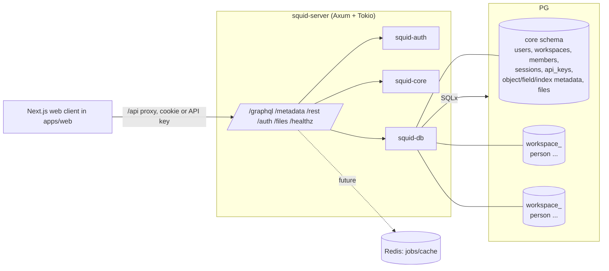
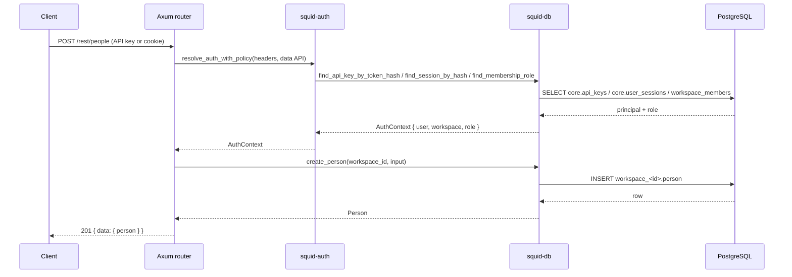
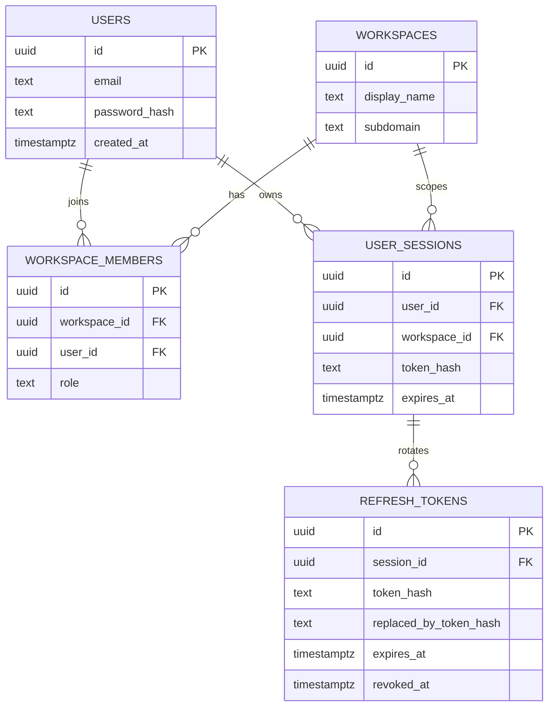

# Architecture Overview

## Runtime topology

## Request lifecycle

## Data model (Phase 4)

Each workspace additionally owns a schema containing object tables (`person` in
the current slice). Workspace-scoped object/field metadata
lives in `core.object_metadata` / `core.field_metadata` and is seeded lazily:
the standard `person` object plus its 16 fields, and one default table view with
five view fields. See ADR 0004. The web client boot query (`currentUser`) is
served from the same core rows with static defaults for unimplemented
enterprise surfaces (ADR 0005).

## Security boundary summary

- Credentials: Argon2id password hashes; HS256 access/login JWTs with `typ`,
  `sid`, `jti`; opaque, rotating, hashed refresh tokens.
- Sessions: opaque tokens, SHA-256 hashed at rest, HttpOnly/SameSite=Lax cookie;
  deleting a session revokes its refresh tokens and access tokens.
- API keys: `api_*` bearer tokens, SHA-256 hashed at rest, expiry/revocation checks
  (Secure in production). Data APIs accept API keys or the session cookie, never
  user access tokens; `/metadata` accepts access tokens.
- CSRF: credentialed CORS restricted to `FRONTEND_URL` plus an Origin check on
  unsafe cookie-authenticated requests. Auth endpoints are burst-limited.
- Tenancy: `workspace_id` from the principal only; validated schema identifiers.
- Transport: 2 MiB body limit.
- See `SECURITY.md` and `docs/threat-model.md` (Phase 6) for the full model.
