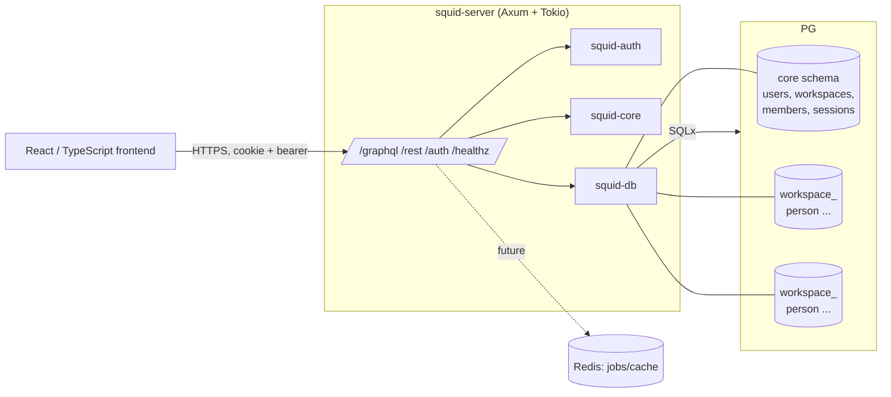
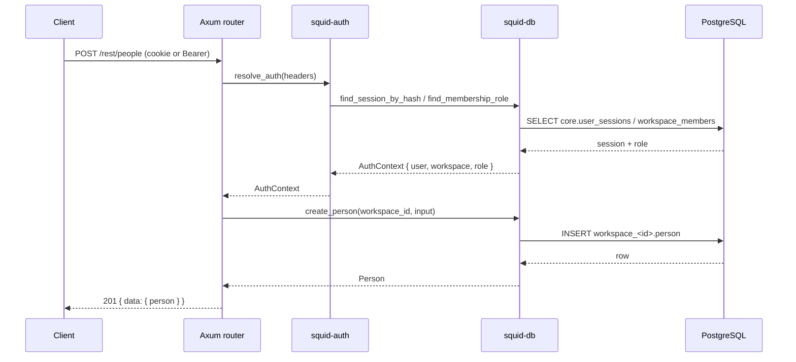
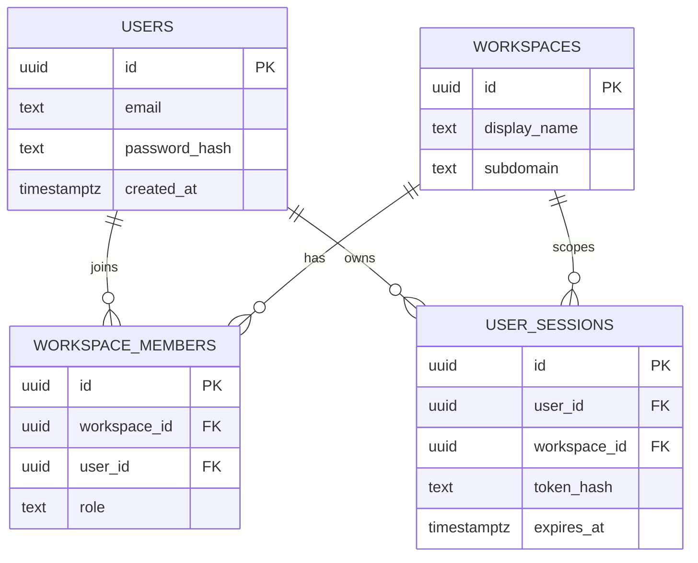

# Architecture Overview

## Runtime topology (Phase 4)

## Request lifecycle

## Data model (Phase 4)

Each workspace additionally owns a schema containing object tables (`person` in
the current slice), mirroring upstream.

## Security boundary summary

- Credentials: Argon2id password hashes; HS256 JWTs with typed claims.
- Sessions: opaque tokens, SHA-256 hashed at rest, HttpOnly/SameSite=Lax cookie
  (Secure in production).
- Tenancy: `workspace_id` from the principal only; validated schema identifiers.
- Transport: credentialed CORS restricted to `FRONTEND_URL`; 2 MiB body limit.
- See `SECURITY.md` and `docs/threat-model.md` (Phase 6) for the full model.
